  

  
  

## Hi, I'm Reca (she/her)

I'm a backend engineer at MAX (Metro Africa Xpress) in Lagos, with about four years of building APIs, data models and payment integrations in Node.js, TypeScript and Go, on top of PostgreSQL. A lot of my work sits close to payments, so reliability and clean data matter in everything I ship.

I also studied Sociology and Anthropology at the University of Benin, and I research health inequality, particularly access to maternal and antenatal care in Nigeria. The two feed each other: engineering makes my research more rigorous, and thinking about people makes me a better engineer. Before tech I worked in radio, teaching and HR, which is probably why I care so much about building things people find easy to use.

## What I work with

| | |
|---|---|
| **Backend** | Node.js, NestJS, Express, Go, TypeScript |
| **Data** | PostgreSQL, Prisma, MongoDB |
| **Payments** | Paystack, Flutterwave |
| **Frontend** | React, Next.js, Tailwind |
| **Also** | Docker, Jest, Zod, REST API design |

## Projects worth a look

**[LISS11 Alumni Website](https://github.com/Onyinye-Reca/LISS)** 
A full-stack site for my secondary school class. It's a monorepo where the frontend and API share one typed contract, so a change to the data shape breaks the build instead of breaking production. Express with InversifyJS and Prisma on the backend, React and Vite on the front, with cookie-based auth and rate-limited login.

**[Lead Manager](https://github.com/Onyinye-Reca/Lead-manager-dashboard)** 
A small lead tracker with an Express and MongoDB API and a Next.js frontend, covered by API tests.

**[Bank Management API](https://github.com/Onyinye-Reca/Bank-Management-API)** 
A TypeScript REST API for accounts and transactions, documented in Postman.

## Right now

- Building a Go service that handles payment webhooks properly: signature checks, idempotency, retries and reconciliation.
- Building a budget tracker that connects to Nigerian bank accounts through Mono and sorts spending automatically. The hard part is making sense of messy bank transaction narrations, so if you've cracked that, I'd love to hear from you.
- Working on a reproducible analysis of inequality in antenatal care using Nigeria DHS data.
- Studying for AWS Solutions Architect Associate, and learning French.

I'm open to collaborating on fintech tools and on apps that support mental health at work. Happy to talk NestJS, PostgreSQL or payment gateway integrations anytime.

## GitHub activity

  
  

  

  

